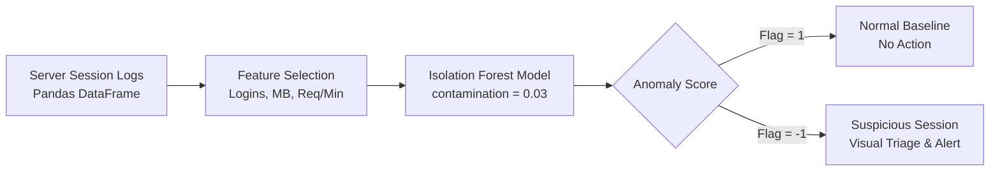

# AI-Driven Server Session Anomaly Detection


**An unsupervised machine learning pipeline built in JupyterLab that analyzes server session telemetry to detect compromised employee accounts, brute-force login bursts, and abnormal data exfiltration.**

Designed for IT operations and Tier-1 security analysts to surface high-risk behavioral outliers without relying on pre-labeled attack datasets or static threshold rules.

---

## Visual Output


*Isolation Forest separates normal employee activity (blue) from high-frequency automated requests and outbound data spikes (red).*

---

## System Architecture & Data Flow



---

## Monitored Telemetry & Threat Indicators

| Feature | Normal Baseline | Anomaly Behavior | Security Threat Mapped |
| :--- | :--- | :--- | :--- |
| **`failed_logins`** | 0–1 per session | Sharp spikes (9–18+) | Credential stuffing / Brute-force attack |
| **`mb_transferred`** | 10–90 MB | High volume (450+ MB) | Data exfiltration / Insider misuse |
| **`requests_per_min`** | 5–35 req/min | Sustained bursts (70–120+) | Automated scraping / Bot activity |

---

## Quick Start

### Prerequisites
* Python 3.11+
* JupyterLab

### Installation & Execution
1. Clone the repository and enter the project folder:
   `git clone https://github.com/yourusername/ai-session-anomaly-detector.git && cd ai-session-anomaly-detector`
2. Install the required data science and ML libraries:
   `pip install jupyterlab pandas scikit-learn matplotlib`
3. Launch JupyterLab:
   `jupyter lab`
4. Open **`anomaly_detection.ipynb`** and click **Run -> Run All Cells** to generate the session dataset, fit the Isolation Forest model, and render the anomaly scatter plot.

---

## Repository Structure

```text
ai-session-anomaly-detector/
├── assets/
│   └── anomaly_scatter.png     # Exported Matplotlib visualization for documentation
├── anomaly_detection.ipynb     # Main JupyterLab notebook with Markdown analysis & code
├── requirements.txt            # Pinned Python dependencies
└── README.md                   # Project architecture and setup guide
```

---

## Key Takeaways & Future Roadmap

* **Tuning Contamination vs. False Positives:** Setting `contamination=0.03` calibrates the model to flag the top 3% most isolated sessions. In production environments, this hyperparameter should be tuned against historical incident rates to prevent alert fatigue.
* **Future Improvements:**
  * [ ] Test the model against a public intrusion dataset (such as NSL-KDD or CIC-IDS).
  * [ ] Add automated CSV/JSON export for flagged user IDs so downstream SOAR or firewall scripts can revoke active tokens.
